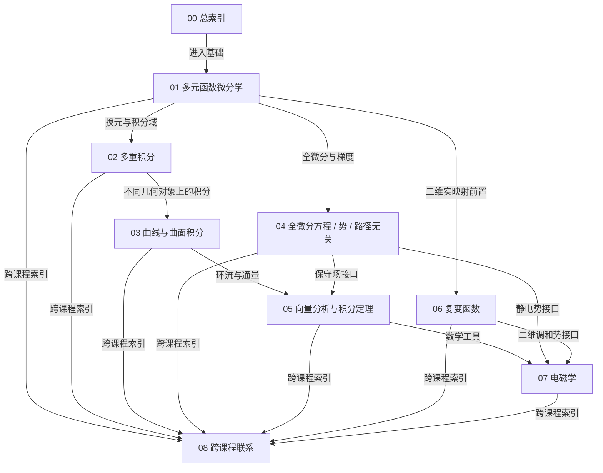

# 总索引与知识地图

> 这是第二版模块化草稿的入口。知识定义和推导位于 01–07；真正的跨课程桥梁位于 08。本文件只回答“有哪些区域、应该去哪里找、建议按什么顺序读”。

## 本节位置

前置：

- [聊天材料索引](../sources/聊天材料索引.md)
- [视频来源索引](../sources/视频来源索引.md)
- 旧版《复变函数_多元微积分_电磁学_统一梳理.md》与结构图，仅作迁移参考

后续：

- [01 多元函数微分学](01_多元函数微分学.md)
- [02 多重积分](02_多重积分.md)
- [03 曲线积分与曲面积分](03_曲线积分与曲面积分.md)
- [04 全微分方程、势函数与路径无关](04_全微分方程_势函数_路径无关.md)
- [05 向量分析与积分定理](05_向量分析与积分定理.md)
- [06 复变函数](06_复变函数.md)
- [07 电磁学](07_电磁学.md)

相关：

- [08 跨课程联系](08_跨课程联系.md)

跨课程联系：

- [五座核心桥梁](08_跨课程联系.md)

## 1. 30 秒目录图

> 图中箭头只表示**文件前置或建议阅读关系**，不表示数学推导或严格等价。



这张图不声称“01 推出 02”或“06 推出 07”。例如，$06\to07$ 只表示复分析为二维无源势问题提供工具，而不是整个电磁学建立在复分析之上。

## 2. 文件职责：一个问题只在一个地方完整讲

| 文件 | 知识本体 | 主要保留的个人问题 |
|---|---|---|
| [01 多元函数微分学](01_多元函数微分学.md) | 多元极限、偏导、方向导数、全微分、可微、局部线性化、链式法则、Jacobian | 为什么只看几个方向不能自动代表全部局部变化；偏导为何不是完整导数 |
| [02 多重积分](02_多重积分.md) | 一重到高维积分、Riemann 和、Fubini、极/柱/球坐标、换元 Jacobian | 为什么二维累加可变成累次积分；微元和积分域究竟是什么 |
| [03 曲线积分与曲面积分](03_曲线积分与曲面积分.md) | 两类曲线积分、两类曲面积分、参数化、方向、通量 | 为什么已有二重/三重积分仍要新积分；参数化后到底变成什么 |
| [04 全微分方程、势函数与路径无关](04_全微分方程_势函数_路径无关.md) | 恰当微分方程、势函数、保守场、路径无关、闭路积分、无旋、拓扑 | 势函数为何存在；如何反向构造；有势与无旋是否真能互推 |
| [05 向量分析与积分定理](05_向量分析与积分定理.md) | grad/div/curl/Laplacian、Green/Gauss/Stokes、局部—整体 | 旋度为什么除面积；$C^1/C^2$ 条件约束谁；源汇与环流的含义 |
| [06 复变函数](06_复变函数.md) | 复函数、复导数、CR、全纯/解析、调和、复积分、Cauchy 理论 | 复数无序如何谈导数；为何看 $x$ 偏导；复积分与实曲线积分的层次 |
| [07 电磁学](07_电磁学.md) | 电荷、电场、电势、电流、磁场、感应、Maxwell 方程 | 数学定理和物理定律是什么关系；何时电场保守 |
| [08 跨课程联系](08_跨课程联系.md) | 五座跨课程桥梁及其关系类型 | 哪些是真等价，哪些只是表示、应用或结构类比 |

## 3. 建议阅读路线

### 路线 A：从基础重建

```text
01 多元函数微分学
→ 02 多重积分
→ 03 曲线积分与曲面积分
→ 04 全微分方程 / 势 / 路径无关
→ 05 向量分析与积分定理
→ 07 电磁学
```

这条路线适合修复多元微积分断层，并把 Green/Gauss/Stokes 建立在已经理解的积分对象之上。

### 路线 B：解决复分析中的断层

```text
01 的多元极限与局部线性化
→ 06 的复极限、复导数与 CR
→ 03 的曲线参数化
→ 06 的复积分
→ 04 的原函数 / 路径无关结构对照
```

### 路线 C：解决“势函数为何存在”

```text
01 的全微分
→ 04 的恰当微分方程
→ 04 的势函数反向构造
→ 05 的无旋条件
→ 07 的静电势
```

### 路线 D：30 分钟恢复全局地图

1. 先读本文件第 1、2 节；
2. 读 [08 跨课程联系](08_跨课程联系.md) 的五张桥梁图；
3. 只打开自己当前卡住的知识本体文件；
4. 最后回到该文件中的“我的理解记录”。

## 4. 专题图在哪里

为避免一张图承担证明、目录和类比三种任务，专题图集中在 [08 跨课程联系](08_跨课程联系.md)：

- [图 A：全微分—势函数—路径无关](08_跨课程联系.md#桥梁-a全微分势函数路径无关)
- [图 B：积分家族](08_跨课程联系.md#桥梁-b一重二重三重曲线与曲面积分)
- [图 C：局部量与整体量](08_跨课程联系.md#桥梁-c局部量与整体量)
- [图 D：复可微与多元微分](08_跨课程联系.md#桥梁-d复分析与多元微分)
- [图 E：复分析与二维静电势](08_跨课程联系.md#桥梁-e复分析与电磁学)

每张图后都有条件、关系类型与正文链接。图本身不是证明。

## 5. 快速查找：遇到问题应该打开哪里

| 当前问题 | 首选入口 |
|---|---|
| 多元极限为什么要检查不同路径 | [多元极限与连续](01_多元函数微分学.md#多元极限与连续) |
| 偏导、方向导数和可微有什么区别 | [从偏导到全微分](01_多元函数微分学.md#偏导数) |
| $df=f_xdx+f_ydy$ 到底是什么 | [全微分与可微](01_多元函数微分学.md#全微分与可微) |
| Jacobian 为什么一会儿是矩阵、一会儿是换元因子 | [Jacobian](01_多元函数微分学.md#jacobian) 与 [换元](02_多重积分.md#换元与-jacobian) |
| 二重积分为何能写成累次积分 | [Fubini 与累次积分](02_多重积分.md#fubini-与累次积分) |
| 曲线积分为何要参数化 | [参数化](03_曲线积分与曲面积分.md#参数化) |
| 全微分方程为何得到 $F(x,y)=C$ | [全微分方程](04_全微分方程_势函数_路径无关.md#全微分方程) |
| 势函数为何能由路径积分构造 | [反向构造势函数](04_全微分方程_势函数_路径无关.md#从路径无关反过来构造势函数) |
| 无旋是否一定有势 | [局部与全局条件](04_全微分方程_势函数_路径无关.md#无旋条件局部与全局) |
| 旋度为什么除以面积 | [旋度](05_向量分析与积分定理.md#旋度) |
| Green、Gauss、Stokes 分别连接什么 | [积分定理](05_向量分析与积分定理.md#三个积分定理) |
| 复导数为何比普通二元可微强 | [复导数](06_复变函数.md#复导数) |
| CR 是必要还是充分 | [Cauchy–Riemann 条件](06_复变函数.md#cauchy-riemann-条件) |
| 复积分到底是哪一种积分 | [复积分](06_复变函数.md#复积分) |
| 电场什么时候路径无关 | [静电势](07_电磁学.md#电势势能与静电场) |
| Maxwell 四式为何两散度、两旋度 | [Maxwell 方程组](07_电磁学.md#maxwell-方程组不是四条孤立公式) |

## 6. 旧稿迁移说明

旧文件没有删除或覆盖：

- `../复变函数_多元微积分_电磁学_统一梳理.md`
- `../复变函数_多元微积分_电磁学_结构图.md`
- `../复变函数_多元微积分_电磁学_节点表.md`

### 已拆入新文件

| 旧稿内容 | 新位置 |
|---|---|
| 导数、场、梯度和 Jacobian | 01 |
| 旧稿未充分展开的一重/二重/三重积分 | 02 新建主线 |
| 两类曲线积分、两类曲面积分、参数化 | 03 |
| 势函数、保守场、路径无关、洞 | 04，并补入全微分方程 |
| 散度、旋度、Green/Gauss/Stokes | 05 |
| 复函数、CR、解析、调和、复积分 | 06 |
| 静电势和 Maxwell 方程 | 07 |
| 概念对应、严格等价与结构类比 | 08 |
| 旧结构图中的总览与专题图 | 00 目录图 + 08 专题图 |
| 认知转折和易混淆问题 | 分散回其对应知识文件，不再集中压缩成一节 |

### 没有机械迁移的内容

- 旧稿“一篇文章连续读完”的叙事顺序没有复制；它正是本轮要替换的组织方式。
- 自动转录中的口误、同音词和无法由画面核验的公式没有进入知识正文。
- 旧稿 AI 补充中的微分形式、Helmholtz 分解和场论只保留为后续入口，没有假装已完整展开。
- 视频中的大量计算技巧和具体例题没有全部抄入概念骨架；它们仍可通过来源时间轴回看。

### 建议人工保留的旧内容

- 旧《统一梳理》可作为“第一版思路快照”，用于观察理解结构如何变化；
- 旧《结构图》可保留作反例审查：检查哪些箭头曾把相关性误画成推导；
- 旧《节点表》可保留作理解状态的初始基线，之后可逐节点更新，而不是覆盖历史状态。

## 7. 本知识库的编辑规则

以后增加内容时优先遵守：

1. 定义和完整推导只放在一个知识本体文件；
2. 其他文件使用相对 Markdown 链接，不复制整段；
3. 每条跨课程边写清关系类型和成立条件；
4. 用户连续追问的问题保留问题链，不只保留答案；
5. 暂不稳定的理解放入“仍需确认”，不强行改写成结论；
6. Mermaid 只负责总览，Markdown 链接才是可维护骨架；
7. 数学公式统一使用浏览器兼容的 `$...$` 与 `$$...$$` 定界符。

## 8. 来源入口

- [聊天问题链与认知转折](../sources/聊天材料索引.md)
- [视频标题、章节时间轴与转录说明](../sources/视频来源索引.md)
- `../sources/transcripts/`：七份带时间戳自动转录，仅作定位线索，数学符号需独立核验。

## 返回知识地图

当前文件就是总索引。回到顶部可重新选择阅读路线。

[返回总索引](00_总索引与知识地图.md)
