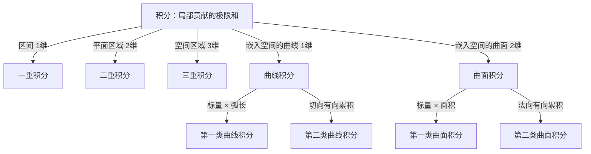
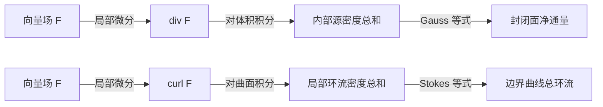
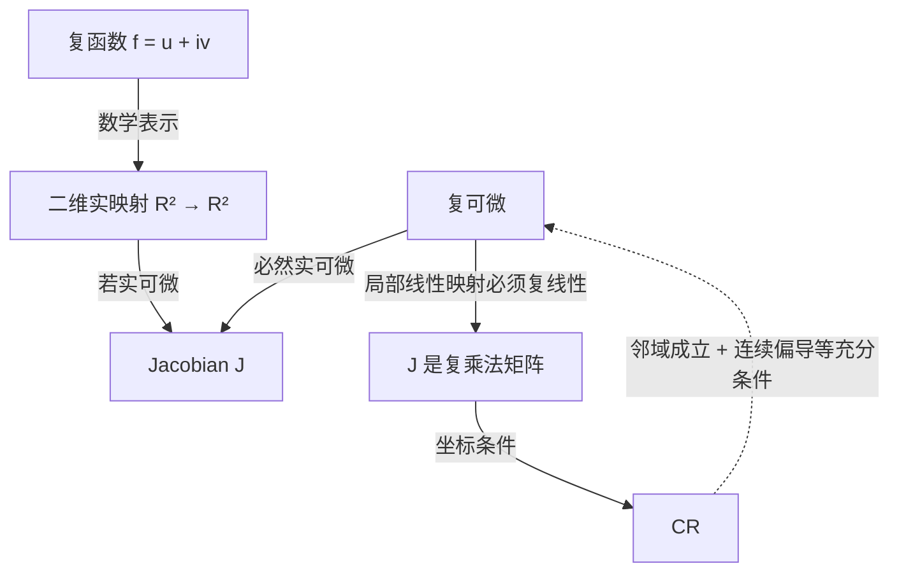
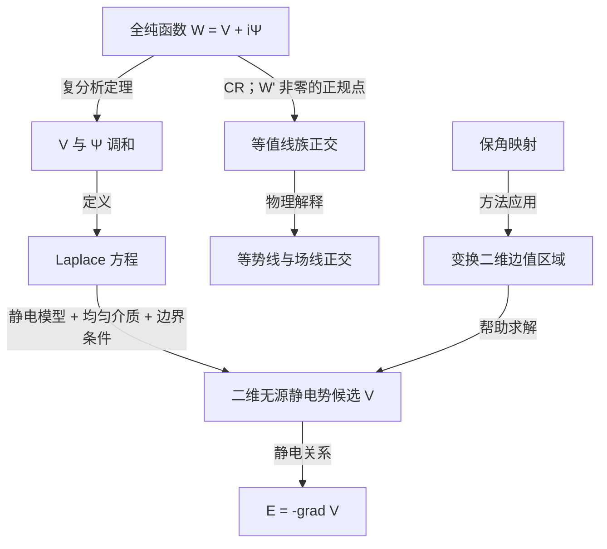

# 跨课程联系

> 各主题的定义和完整推导留在各自文件。本文件只记录真正跨越课程边界的桥梁，并明确每条连接属于定义、推导、条件等价、数学表示、物理应用还是结构类比。

## 本节位置

前置：

- [多元函数微分学](01_多元函数微分学.md)
- [多重积分](02_多重积分.md)
- [曲线积分与曲面积分](03_曲线积分与曲面积分.md)
- [全微分方程、势函数与路径无关](04_全微分方程_势函数_路径无关.md)
- [向量分析与积分定理](05_向量分析与积分定理.md)
- [复变函数](06_复变函数.md)
- [电磁学](07_电磁学.md)

后续：

- 偏微分方程中的边值问题
- 理论力学中的保守力与势能
- 保角映射与二维势问题
- 微分形式与广义 Stokes 定理

相关：

- [总索引与知识地图](00_总索引与知识地图.md)

跨课程联系：

- 本文件就是跨课程连接层；知识本体不在这里重复展开。

## 0. 先规定箭头的语言

旧稿的主要风险之一，是把“前置”“推导”“应用”和“看起来相似”画成同一种箭头。本轮采用以下关系词：

| 标记 | 含义 | 能否反向 |
|---|---|---|
| 定义 | 后一对象直接由前一对象定义 | 通常不能自动反向 |
| 推导 | 在已写出的假设下可证明 | 要另证逆命题 |
| 条件等价 | 在明确光滑性、区域等条件下可互推 | 可以，但不能删掉条件 |
| 数学表示 | 同一对象的另一种坐标或语言 | 一般可互换 |
| 物理应用 | 数学结构在某个物理情形中的实现 | 不是数学定义 |
| 结构类比 | 共享形式或组织方式 | 不允许据此互推 |
| 文件前置 | 学习顺序或依赖关系 | 不是数学命题 |

Mermaid 图只作视觉索引。严格内容以图后的文字、条件和链接为准。

## 桥梁 A：全微分—势函数—路径无关

### 关系图

```mermaid
flowchart TD
    A[可微标量函数 φ] -->|定义其全微分| B[dφ]
    A -->|取梯度| C[F = grad φ]
    B -->|坐标表示| D[M dx + N dy]
    D -->|令 dφ = 0| E[恰当微分方程]
    C -->|线积分基本定理| F[端点差 φ(B)-φ(A)]
    F -->|推出| G[路径无关]
    G -->|推出| H[任意闭路积分为 0]
    H -->|两路径拼接；路径连通| G
    G -->|D 开且路径连通；F 连续；固定基点积分| A
    I[curl F = 0] -.->|单连通 + C¹ 等条件下| C
    C -->|足够光滑时| I
```

这里不是一条无条件的循环箭头。应分三层看。

### 第一层：同一局部线性结构的不同写法

若 $\phi(x,y)$ 可微，

$$
d\phi=\phi_x\,dx+\phi_y\,dy.
$$

令 $M=\phi_x,N=\phi_y$，则

$$
d\phi=M\,dx+N\,dy.
$$

这是全微分的坐标表达，不是物理类比。完整解释见 [全微分与可微](01_多元函数微分学.md#全微分与可微)。

### 第二层：从恰当微分到势函数和保守场

若 $M\,dx+N\,dy=d\phi$，令向量场 $\mathbf F=(M,N)$，便有

$$
\mathbf F=\nabla\phi,
\qquad
\mathbf F\cdot d\mathbf r=d\phi.
$$

于是沿任意分段光滑路径：

$$
\int_A^B\mathbf F\cdot d\mathbf r
=\phi(B)-\phi(A).
$$

因此积分只依赖端点。这里用到的是多元链式法则和一元微积分基本定理，而不是一句“保守场所以路径无关”。完整推导见 [路径无关](04_全微分方程_势函数_路径无关.md#路径无关)。

### 第三层：反向构造与拓扑条件

设定义域 $D$ 开且路径连通、$\mathbf F$ 连续，并且任意两点间的积分已知路径无关。固定 $P_0$，定义

$$
\phi(P)=\int_{P_0}^{P}\mathbf F\cdot d\mathbf r.
$$

路径无关保证同一个 $P$ 不会因选路不同得到多个值，所以定义良好。再通过端点沿坐标方向的小移动证明 $\nabla\phi=\mathbf F$。

而“$\nabla\times\mathbf F=0$ 能否推出有势”还要检查光滑性与区域是否有洞。集中见 [无旋条件：局部与全局](04_全微分方程_势函数_路径无关.md#无旋条件局部与全局)。

### 向物理延伸

静电场中

$$
\mathbf E=-\nabla V
$$

是这套数学结构的一种物理实现；负号来自电势定义约定。它不是“势函数”这个数学概念的定义，参见 [电势与静电场](07_电磁学.md#电势势能与静电场)。

## 桥梁 B：一重、二重、三重、曲线与曲面积分

统一积分家族时，应先问“在哪个几何对象上累积”，而不是数积分号。



| 积分 | 积分域 | 微元 | 是否天然有取向 | 典型意义 |
|---|---|---|---|---|
| $\int_a^b f(x)\,dx$ | 区间 | $dx$ | 区间上下限给方向 | 一维累积 |
| $\iint_D f\,dA$ | 平面区域 | $dA$ | 面积元本身无方向 | 面积上的累积 |
| $\iiint_V f\,dV$ | 空间区域 | $dV$ | 体积元本身无方向 | 体积中的累积 |
| $\int_C f\,ds$ | 曲线 | $ds$ | 无 | 沿曲线累加标量 |
| $\int_C\mathbf F\cdot d\mathbf r$ | 有向曲线 | $d\mathbf r$ | 有 | 做功、环流 |
| $\iint_S f\,dS$ | 曲面 | $dS$ | 无 | 沿曲面累加标量 |
| $\iint_S\mathbf F\cdot\mathbf n\,dS$ | 有向曲面 | $\mathbf n\,dS$ | 有 | 通量 |

二重积分和曲面积分都可能“看起来有两个参数”，但前者直接在二维区域上积，后者在嵌入三维空间的二维曲面上积，需要参数化所产生的面积缩放。完整知识分别见 [多重积分](02_多重积分.md) 与 [曲线积分和曲面积分](03_曲线积分与曲面积分.md)。

> **关键纠正**：曲线积分不是“二重积分的下一章”，曲面积分也不是“三重积分”。它们按积分域的几何对象分类，而不是按课程出现顺序分类。

## 桥梁 C：局部量与整体量

### 两条主干



关系不是“div 经过 Gauss 变成 flux”，而是：

$$
\iiint_V\nabla\cdot\mathbf F\,dV
=
\oiint_{\partial V}\mathbf F\cdot\mathbf n\,dS,
$$

$$
\iint_S(\nabla\times\mathbf F)\cdot\mathbf n\,dS
=
\oint_{\partial S}\mathbf F\cdot d\mathbf r.
$$

左边积分局部微分量，右边测边界上的整体效应。内部小块边界以相反取向成对抵消，是理解两式的共同几何机制。

### Green 在哪里

Green 定理是在平面区域中把区域二重积分与边界曲线积分相连。它既可写成二维环流形式，也可写成二维通量形式，因此分别对应 Stokes 与 Gauss 的二维版本。详见 [向量分析与积分定理](05_向量分析与积分定理.md#green-定理)。

### 电磁学如何调用

Maxwell 的两条散度方程通过 Gauss 定理变成封闭面通量式；两条旋度方程通过 Stokes 定理变成回路环流式。这是数学表示的转换，不是用数学定理创造物理定律。参见 [Maxwell 方程组](07_电磁学.md#maxwell-方程组不是四条孤立公式)。

## 桥梁 D：复分析与多元微分

### 不是“CR 自动推出复可微”



一般实线性映射 $\mathbb R^2\to\mathbb R^2$ 有矩阵

$$
J=
\begin{pmatrix}
u_x&u_y\\
v_x&v_y
\end{pmatrix}.
$$

若它来自乘以复数 $a+ib$，矩阵必须是

$$
\begin{pmatrix}
a&-b\\
b&a
\end{pmatrix}.
$$

两者比较得到 Cauchy–Riemann 条件。这里的桥梁是“同一个局部线性映射的两种语言”。普通多元可微知识见 [局部线性化](01_多元函数微分学.md#局部线性化)，复分析内部逻辑见 [复导数](06_复变函数.md#复导数) 与 [Cauchy–Riemann 条件](06_复变函数.md#cauchy-riemann-条件)。

> ⚠️ CR 在一点成立通常不足以推出该点复可微。图中的虚线箭头刻意标出常用充分条件，不能改成无条件实线。

## 桥梁 E：复分析与电磁学

这座桥只直接覆盖二维势问题，不覆盖整个三维时变电磁学。



若 $W(z)=V(x,y)+i\Psi(x,y)$ 全纯，则实、虚部满足

$$
\nabla^2V=0,
\qquad
\nabla^2\Psi=0.
$$

在真空或介电常数均匀的无自由电荷静电区域，电势也满足

$$
\nabla^2V=0.
$$

这是同一个 Laplace 方程在复分析与物理中的直接连接。不过，任意调和函数只是局部方程的候选解；要成为具体物理问题的电势，还必须满足边界条件。CR 还给出 $\nabla V\cdot\nabla\Psi=0$。在 $W'(z)\neq0$、两梯度非零的正规点，两族等值线正交；临界点处角度可能没有定义。再结合 $\mathbf E=-\nabla V$，$\Psi$ 的等值线才可在相应符号约定下解释为电场线族。

但要注意：

- “解析函数实部调和”是复分析结论；
- “无源静电势满足 Laplace 方程”来自静电学方程；
- 具体静电势还需材料模型和边界条件，不能由 Laplace 方程单独选定；
- 二者通过共同方程连接，不表示电磁学等同于复分析；
- 时变三维电磁场仍主要依赖向量分析、偏微分方程和场论。

详见 [复变函数：调和函数](06_复变函数.md#调和函数) 和 [电磁学：Poisson 与 Laplace 方程](07_电磁学.md#poisson-与-laplace-方程)。

## 6. 两种“原函数 / 势函数”和两种路径无关

| 项目 | 实向量场 | 复分析 |
|---|---|---|
| 被积对象 | $\mathbf F\cdot d\mathbf r$ | $f(z)\,dz$ |
| 原对象 | 势函数 $\phi$，满足 $\nabla\phi=\mathbf F$ | 复原函数 $F$，满足 $F'=f$ |
| 端点公式 | $\int_A^B\mathbf F\cdot d\mathbf r=\phi(B)-\phi(A)$ | $\int_\gamma f(z)dz=F(z_2)-F(z_1)$ |
| 局部条件 | 闭 1-形式 / 无旋 | 全纯性带来的闭性结构 |
| 全局障碍 | 区域中的洞 | 区域中的洞；例如 $1/z$ |

两者共享“恰当微分—原函数—闭路积分—拓扑障碍”的抽象骨架，但不是同一个定理。复积分拆成两个实曲线积分，且 CR 同时约束这两个实部分；不能把它等同于某一个电场线积分。

对照阅读：

- [实向量场的路径无关](04_全微分方程_势函数_路径无关.md#路径无关)
- [复积分的原函数与路径无关](06_复变函数.md#原函数与路径无关)
- [静电势](07_电磁学.md#电势势能与静电场)

## 7. 从我的反复追问中得到的建图规则

两段对话反复出现相同的认知过程：

```text
看到公式外观相似
↓
追问两个对象是否真是同一类对象
↓
追问局部量为什么要除以长度/面积/体积
↓
追问箭头能否反向
↓
发现需要光滑性、区域和拓扑条件
↓
形成“对象 + 关系类型 + 条件 + 反例”的稳定节点
```

因此以后给知识图增加边时，应同时写出四项：

1. 起点和终点各是什么类型的对象；
2. 箭头是定义、推导、条件等价、应用还是类比；
3. 成立需要哪些条件；
4. 删除条件后是否有最小反例。

这条规则比继续添加更多箭头更重要。

## 8. 下一步接口，但本轮不展开

- **理论力学**：保守力、功、势能与广义坐标；
- **偏微分方程**：Laplace/Poisson 方程的边界条件、唯一性与 Green 函数；
- **保角映射**：把复杂二维区域变换成易解区域；
- **微分形式**：用 $d\omega$ 与边界积分统一 Green、Gauss、Stokes；
- **Helmholtz 分解**：在合适条件下由散度、旋度和边界信息重建向量场。

这些是自然延伸，不等于当前知识骨架已经证明了它们。

## 返回知识地图

[返回总索引](00_总索引与知识地图.md)
